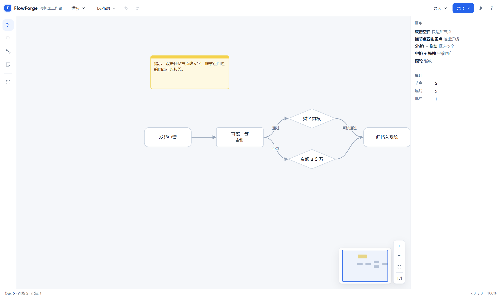
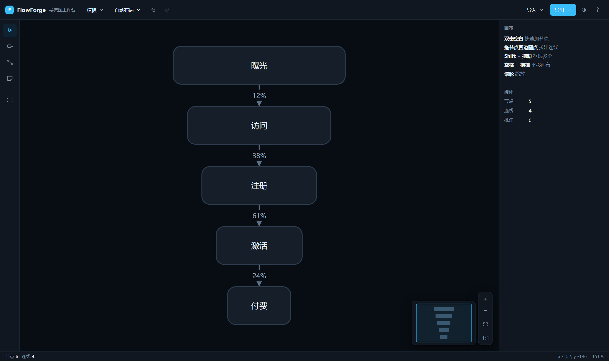

# FlowForge · 导流图工作台

一个**零依赖、单文件**的流程图 / 数据流向图编辑器。双击 `index.html` 就能用，不需要装环境、不需要联网、不上传任何数据。

[在线使用](https://shexiao123.github.io/flowforge/) · [功能](#功能) · [快捷键](#快捷键) · [文件格式](#文件格式)

---

## 为什么是单文件

绝大多数画图工具要么绑账号、要么要装客户端、要么导出带水印。

FlowForge 只有一个 `index.html`，里面装着全部 HTML / CSS / JavaScript。你可以：

- 双击打开就用，断网也能画
- 拷到 U 盘、丢进邮件附件、挂在任何静态服务器上
- 用浏览器直接 `Ctrl+S` 存成工程文件发同事

数据默认存在浏览器本地（localStorage），关掉页面再打开还在。

---

## 截图

浅色主题（首次打开自带一份审批流示例）：



深色主题（转化漏斗模板）：



---

## 功能

### 画布与节点

- **无限画布**：滚轮以光标为中心缩放（15% ~ 400%），空格 / 中键拖拽平移
- **小地图**：右下角缩略图，显示当前视口位置，点击或拖拽即可跳转
- **五种节点形状**：矩形、圆角、菱形、椭圆、数据圆柱
- **双击空白** 直接新建节点并进入输入状态
- **节点四周锚点**：选中或悬停时浮现，从任意一边拖出连线
- **对齐吸附**：拖动节点靠近其它节点时自动吸附，并显示对齐参考线；按住 `Alt` 可临时关闭
- **文字自动撑高**：节点文字换行超出高度时，节点自动长高，不会溢出到框外
- **多选**：Shift 点击加选、Shift 拖拽框选、Ctrl+A 全选
- **对齐与分布**：左/中/右、上/中/下对齐，水平/垂直等距分布
- **图层顺序**：置顶 / 置底，解决节点相互遮挡
- **方向键微移**：1px 精调，Shift + 方向键 10px

### 连线

- 拖拽锚点即连，松开在目标节点上完成
- 自动选择最合适的进出边（上下左右自动判断）
- 支持手动指定起点 / 终点方位
- 可加标签、可切实线 / 虚线、可单独设置颜色
- **双击连线直接改标签**，不用绕去右侧面板
- 曲线走线，箭头自动朝向，标签自动退到底色上

### 布局与模板

- **自动分层布局**：按拓扑关系分层，带重心排序减少交叉，支持「从左到右」「从上到下」
- **四套内置模板**：审批流程、数据管道、转化漏斗、系统架构

### 主题与批注

- **深浅双主题**，一键切换。节点颜色可跟随主题，也可单独指定
- **批注便签**：在图上贴黄色便签写说明，可拖动、改色、随工程一起导出

### 编辑体验

- **复制粘贴**：`Ctrl+C` / `Ctrl+V` 跨图搬运，连续粘贴自动错位
- **右键上下文菜单**：节点（复制 / 置顶置底 / 删除）、连线（改标签 / 换线型 / 反向）、画布（粘贴 / 全选 / 自动布局 / 导出）
- **输入框隔离**：在右侧面板里打字时，`Ctrl+Z`、`Delete`、方向键只作用于文字，不会误伤画布
- **渲染节流**：拖拽期间的重绘合并到动画帧，减少重复重建

### 导入导出

| 格式 | 说明 |
|---|---|
| **PNG** | 2 倍分辨率高清图，纯导出不截界面，背景实心不透明 |
| **SVG** | 矢量图，无限放大不糊，可直接塞进设计稿或网页 |
| **JSON** | 完整工程文件，含节点、连线、便签，可再次导入 |
| **CSV** | 导出两份（节点表 + 连线表），Excel 可直接打开（带 BOM，不乱码） |

CSV 支持反向导入，节点表和连线表按表头自动识别。

### 其他

- **撤销 / 重做**：150 步历史，覆盖拖拽、删除、对齐、改属性、导入等所有操作
- **自动保存**：每次改动自动写入浏览器本地存储
- **完整性**：全程无第三方依赖，无 CDN，无网络请求

---

## 快速开始

### 方式一：直接双击

双击 `index.html`，用浏览器打开即可。

### 方式二：一键脚本（Windows）

双击 `start.bat`，会用默认浏览器打开。

### 方式三：起个本地服务（可选）

```bash
# Python 3
python -m http.server 8080
# 然后访问 http://localhost:8080
```

单文件不依赖 `file://` 协议特性，这两种方式都能正常跑。

---

## 快捷键

| 按键 | 功能 |
|---|---|
| `双击空白` | 新建节点并输入 |
| `双击节点` | 编辑文字 |
| `双击连线` | 编辑连线标签 |
| `拖节点锚点` | 拉出连线 |
| `拖拽节点` | 靠近其它节点自动吸附对齐 |
| `Alt` + 拖拽 | 临时关闭吸附 |
| `Shift` + 点击 | 加选 / 减选 |
| `Shift` + 拖空白 | 框选 |
| `空格` + 拖拽 / 中键拖拽 | 平移画布 |
| `滚轮` | 缩放 |
| `小地图` | 点击或拖拽跳转视口 |
| `Ctrl+Z` / `Ctrl+Y` | 撤销 / 重做 |
| `Ctrl+A` | 全选节点 |
| `Ctrl+C` / `Ctrl+V` | 复制 / 粘贴节点 |
| `Ctrl+D` | 原地复制一份 |
| `Delete` | 删除选中 |
| `方向键` / `Shift`+`方向键` | 微移 1px / 10px |
| `V` `N` `C` `M` | 选择 / 加节点 / 连线 / 批注 |
| `F` | 适配视图 |
| `Ctrl+S` / `Ctrl+E` | 导出 JSON / 导出 PNG |
| `Esc` | 取消选择，退出当前工具 |
| `右键` | 上下文菜单 |
| `?` | 打开帮助 |

Mac 上把 `Ctrl` 换成 `Cmd` 同样有效。

---

## 文件格式

### JSON 工程文件

```json
{
  "app": "FlowForge",
  "version": 1,
  "nodes": [
    { "id": "n1", "x": 0, "y": 0, "w": 170, "h": 64,
      "text": "节点文字", "shape": "rect",
      "fill": "", "stroke": "", "textColor": "", "fontSize": 14 }
  ],
  "edges": [
    { "id": "e1", "from": "n1", "to": "n2", "label": "",
      "fromSide": "auto", "toSide": "auto", "dashed": false, "color": "" }
  ],
  "notes": [
    { "id": "t1", "x": 0, "y": -160, "w": 180, "h": 110,
      "text": "批注内容", "color": "" }
  ]
}
```

- `shape`：`rect` | `round` | `diamond` | `ellipse` | `cylinder`
- `fromSide` / `toSide`：`auto` | `l` | `r` | `t` | `b`
- `fill` / `stroke` / `color` 留空字符串表示跟随当前主题

### CSV 节点表

```csv
id,text,shape,x,y,w,h,fill,stroke
a,数据源,cylinder,0,0,150,60,,
b,清洗,round,220,0,150,60,,
```

### CSV 连线表

```csv
from,to,label,dashed,fromSide,toSide
a,b,增量,0,auto,auto
```

`from` / `to` 填的是节点表里的 `id`，不是文字。

---

## 已知限制

说清楚比让人踩坑强：

1. **没有实时多人协作。** 这是个纯前端单文件，没有服务端。所谓的「批注」，是贴在图上的便签，跟着 JSON 一起导出给对方——不是实时同步。真要多人同时编辑，得自己接后端。
2. **数据存在浏览器本地。** 换浏览器、换设备、清缓存都会丢。重要工程请导出 JSON 备份。
3. **CSV 导出是两份文件。** 节点和连线拆成两张表，因为列结构不同。浏览器可能会弹两次下载提示。
4. **PNG 导出用的是 SVG 序列化 + Canvas 绘制。** 用系统字体渲染，跟屏幕上看到的完全一致；但如果你的系统没装某个字体，会回落到默认字体。
5. **约两千节点以上会变慢。** 每次改动是全量重建 SVG，几百个节点很流畅（拖拽已做动画帧合并），两千以上会有可感知延迟。真要画这么大的图，建议拆成多个文件。
6. **双击判定窗口 330ms。** 快速连点同一节点会被判定为「进入编辑」，这是刻意设计；如果系统里把双击速度调得很慢，可能偶尔需要多试一次。

---

## 部署到 GitHub Pages

仓库本身就是一个静态站点，根目录的 `index.html` 可直接发布：

1. 推到 GitHub 仓库
2. Settings → Pages → Source 选 `Deploy from a branch`
3. 分支选 `main`，目录选 `/ (root)`
4. 等一两分钟，访问 `https://<用户名>.github.io/<仓库名>/`

没有构建步骤，没有依赖，推上去就能跑。

---

## 开发与测试

软件本身**零依赖**——`index.html` 跑起来不需要 `npm install`，也不需要构建。

仓库里的 `package.json` 和 `tests/` 只用于自动化回归测试（**38 项用例**，覆盖拖拽、连线、撤销、自动布局、模板、主题、对齐吸附、小地图、复制粘贴、图层、右键菜单、导入导出）：

```bash
npm install     # 只装 puppeteer-core 用于驱动浏览器
npm test
```

| 文件 | 覆盖范围 | 用例数 |
|---|---|---|
| `tests/ui.test.mjs` | 画布核心交互 | 16 |
| `tests/io.test.mjs` | 导入导出与便签 | 8 |
| `tests/features.test.mjs` | 吸附、小地图、SVG、剪贴板、图层、右键菜单 | 14 |

测试需要本机装有 Chrome 或 Edge。装在非标准路径时用环境变量指定：

```bash
CHROME_PATH="/path/to/chrome" npm test
```

---

## 技术说明

- 纯原生 JavaScript（ES6），无框架、无构建工具
- SVG 渲染，节点文字用 `<text>` 而非 `foreignObject`，保证导出 PNG 时文字不丢
- 所有颜色以属性内联写入，不依赖外部样式表，因此克隆 SVG 即可独立出图
- 双击检测由应用自行实现（记录两次 pointerdown 的时间与命中对象），因为选中元素会触发重绘、DOM 被替换，浏览器原生 `dblclick` 会丢失
- 自动布局为简化版 Sugiyama：拓扑分层 → 重心排序 → 坐标分配
- 对齐吸附按拖拽包围盒的 9 个候选边与其它节点求最近距离，容差按屏幕像素换算，缩放后手感一致
- 代码结构：状态 → 几何计算 → 渲染 → 交互 → 面板 → 导入导出，全在一个 IIFE 里

---

## 许可证

[MIT](LICENSE) © 2026 舍先生
